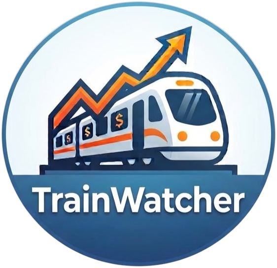
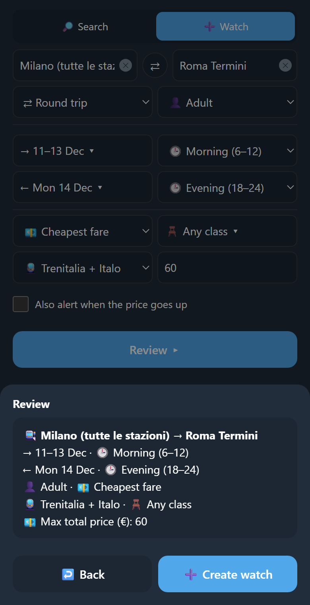
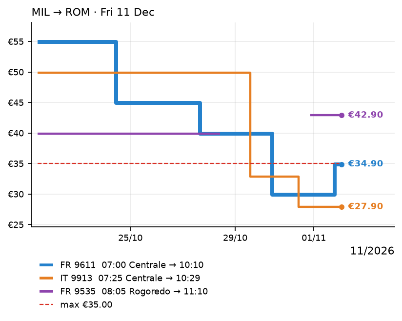

<div align="center">



# TrainWatcher

**Watching Trenitalia and Italo fares day and night,<br>and telling you when it is time to buy.**

[](LICENSE)
[](https://github.com/raffaeledf9/TrainWatcher/actions/workflows/ci.yml)
[](#features)
[](requirements.txt)
[](#how-it-runs)
[](docs/adr/0002-public-repo-with-encrypted-state.md)

</div>

---

TrainWatcher is a Telegram bot that searches Trenitalia's Frecce and Italo on the
days you might travel, and messages you when a fare drops, sells out, comes back,
or is about to stop being sold. You describe the trip once, in a form inside
Telegram; after that there is nothing to do but read the alerts and book.

It is **not a service**. There is no public bot to join. It runs for one owner and
the friends they invite, entirely on free tiers — GitHub Actions, a Cloudflare
Worker and Telegram — and this repository is everything needed to run your own.

> [!NOTE]
> **Fares are read from the operators' public booking sites,** which can change or
> refuse that access at any time. When that happens the bot says so, and says
> whose side the problem is on. It never buys anything: you book on the
> operator's own site.

## Contents

- [Why](#why)
- [Features](#features)
- [How it runs](#how-it-runs)
- [Getting started](#getting-started)
- [Repository layout](#repository-layout)
- [Limitations](#limitations)
- [Tests](#tests)
- [Licence and provenance](#licence-and-provenance)

## Why

Buying a high-speed ticket in Italy at a good price means watching for it:

| | |
|---|---|
| **Fares move** | the cheaper fares sell out, and prices rise and fall from one day to the next — the good one may be gone by the time you look again |
| **Two operators, two sites** | Trenitalia and Italo run many of the same routes and sell them separately, so comparing means two searches for every day you could travel |
| **Several stations per city** | Milano alone has Centrale, Garibaldi, Rogoredo and Rho Fiera; the cheapest train may leave from the one you didn't search |
| **Fares with a deadline** | FrecciaYOUNG, FrecciaSENIOR and Italo's youth and senior fares stop selling 11 days before departure, the same-day return fare 3 days before |

## Features

<div align="center">



<i>The form inside Telegram, with the review sheet open.</i>

</div>

- **A form, not a command syntax.** The 🚄 button next to the message box opens
  the form shown above: route, one day, a month or a custom period of up to 92
  days, a departure-time window, the passenger (adult, young or senior), the
  cheapest fare or specific fares, class, operators and a maximum price, one-way
  or round trip. **Search** answers once; **Watch** keeps looking.

- **Alerts that say what changed.** A new low, a rise (for fare watches, or when
  you ask), going under your maximum, sold out and back on sale, and a warning on
  the last day a fare can still be bought. Each names the trains — with the day,
  for periods, and the station, for "(all)" cities — and carries booking buttons.
  Between 23:00 and 07:00 they arrive silently.

  > 📉 **New low** · Cheapest fare<br>
  > Milano (all) → Roma Termini · Fri 11 Dec
  >
  > **€27.90** ~~€32.90~~ — Italo 9913 07:25 Centrale → 10:29 · Smart
  >
  > ✅ under your max €35.00

- **Round trips priced as pairs.** A total only combines an outbound and a return
  that can be booked together, including Trenitalia's same-day return fare.

- **Answers in a second.** 📋 Status, 📈 price history, `/list` and `/past` come
  back at once, from snapshots the last check left behind; a check itself takes
  about a minute.

- **Long periods stay readable.** A watch over several months arrives as one
  message per month, and many trains at the same price are grouped by day.

- **Friends, on your terms.** One invite link (`/invite`). You are told once who
  asks, approve or decline, and can remove anyone later (`/friends`). Friends get
  up to 5 watches and 12 requests an hour; each chat sees only its own watches,
  and gets its own Monday report.

- **It watches itself.** A test search on Milano → Roma tells "no trains" from
  "operator broken". Three failing runs in a row bring a notice saying whose side
  the problem is on — the operator refusing GitHub's servers, the operator down,
  the network, or the bot needing an update — and another when it recovers. The
  Worker and the job each notice when the other stops, and the GitHub token's
  expiry is announced two weeks ahead.

- **English or Italian**, chosen per chat.

<div align="center">



<i>📈 History: one line per train, the current prices on the right, your maximum dashed.<br>Drawn by the bot's own chart code; the prices here are an example.</i>

</div>

## How it runs

No server and no card. Three free pieces, each doing what the others cannot:

| Part | Does |
|---|---|
| **GitHub Actions** (`.github/workflows/run.yml`) | Searches the operators, sends the alerts, and keeps every watch and price in an AES-256-encrypted SQLite file on the `state` branch. The operators answer GitHub's runners but refuse Cloudflare's ([ADR 0001](docs/adr/0001-fetch-prices-from-github-actions.md)). |
| **Cloudflare Worker** (`worker/`) | The Telegram webhook, the instant replies from D1 snapshots, the form (`webapp/`), and the clock: it starts a run when a command arrives, when a watch is due, and every 2 hours when idle. GitHub's own schedule is only a fallback ([ADR 0003](docs/adr/0003-telegram-webhook-to-worker-with-d1.md)). |
| **Telegram** | The chat, the 🚄 button that opens the form, the alerts. |

A watch is checked every 15 minutes in the last three days before departure,
every 30 minutes up to two weeks, every 2 hours up to 45 days, and every 6 hours
before that. The repository is public because public repositories get free
Actions minutes; the data is not ([ADR 0002](docs/adr/0002-public-repo-with-encrypted-state.md)).

## Getting started

To run your own copy you need Python 3.12, Node (for `wrangler`), the `gh` CLI,
a bot from [@BotFather](https://t.me/BotFather), a Cloudflare account, and a
GitHub token that can start workflows in your fork.

1. **Fork** this repository and keep it public. Point it at your fork: `REPO` in
   `scripts/setup.sh`, `GH_REPO` in `worker/wrangler.toml`, the Worker address in
   `webapp/index.html`, and `GH_TOKEN_EXPIRES` in `trainwatcher/run.py`.
2. **Fill `.env`** (gitignored) with `TELEGRAM_TOKEN`, `OWNER_CHAT_ID` and
   `GH_TOKEN`. The internal secrets are generated for you.
3. **Log in** with `npx wrangler login` and `gh auth login`.
4. **Run** `bash scripts/setup.sh`. It creates the D1 database, deploys the
   Worker, sets the secrets on both sides and registers the Telegram webhook,
   printing statuses only. Run it again to repair anything.
5. **Send `/start`** to your bot.

`git config core.hooksPath .githooks` turns on the pre-push secret scan.

| Document | What it is |
|---|---|
| **[CONTEXT.md](CONTEXT.md)** | the words the code uses: watch, leg, fare watch, owner, friend |
| **[docs/adr/](docs/adr/)** | why GitHub Actions, why a public repository, why a webhook |
| **[docs/data-sources.md](docs/data-sources.md)** | where the station list comes from, and its licence |

## Repository layout

```
trainwatcher/   the job: checks, alerts, messages, charts, the encrypted state
  operators/    the Trenitalia and Italo connectors
worker/         the Cloudflare Worker: webhook, snapshots, queue, invites, the clock
webapp/         the form that opens inside Telegram, and the station list
scripts/        setup, the station-list builder, the secret scan
tests/          unit and end-to-end tests
docs/           decisions, data sources, the original design
.github/        the price-check job and CI
```

## Limitations

- **No official API.** Both connectors read the operators' public booking sites.
  Either operator can change them or refuse GitHub's servers; the bot then shows
  the last prices that worked, and says since when.
- **Direct high-speed trains only.** Trenitalia's Frecce and Italo; no regional
  trains and no changes.
- **Not real time.** Checks follow the cadence above, so a fare that appears and
  sells out between two checks is never seen.
- **One traveller per watch,** adult, young or senior.
- **Shared, free capacity.** The owner is warned at 70% of it; beyond that,
  checks get less frequent for everyone.
- **It never books.** Booking buttons open the operator's site — Italo's with the
  search already filled in.

## Tests

`python -m unittest` runs over 150 tests, on every push as well: unit tests, and
end-to-end runs of the whole job against fake operators, a fake Telegram and the
real Worker code under Node, with SQLite standing in for D1. CI also scans the
whole history for secrets.

## Licence and provenance

The code, scripts, documents and images here are MIT licensed — see [LICENSE](LICENSE).

One exception, not mine to license:

- `webapp/stations.json`, the station list, contains data from Trenitalia S.p.A.
  published through the Italian National Access Point, converted to GTFS by
  [deryclem/trenitalia-gtfs](https://github.com/deryclem/trenitalia-gtfs) and
  licensed [CC BY 4.0](https://creativecommons.org/licenses/by/4.0/), merged with
  the public station lists of trenitalia.com and Italo. Sources and changes are in
  [docs/data-sources.md](docs/data-sources.md).

Fares are read from the public booking sites of Trenitalia and Italo at run time,
and kept only in the encrypted state. They may be out of date or wrong: check them on the
operator's site before buying.

**TrainWatcher is a personal project, not affiliated with Trenitalia, Italo or the CCISS.**
